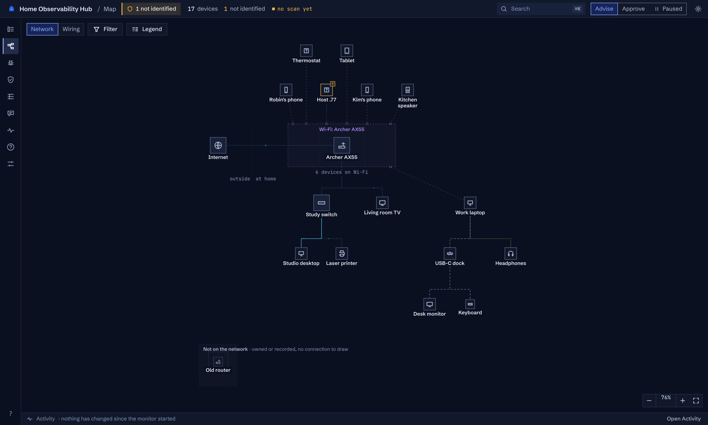
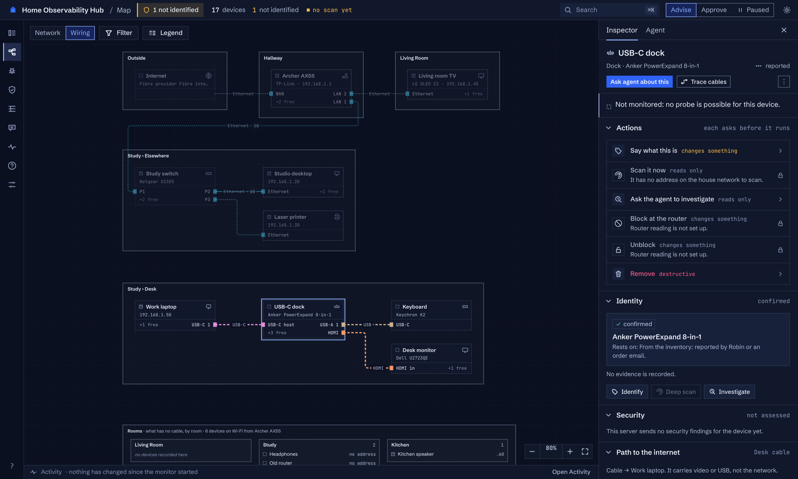
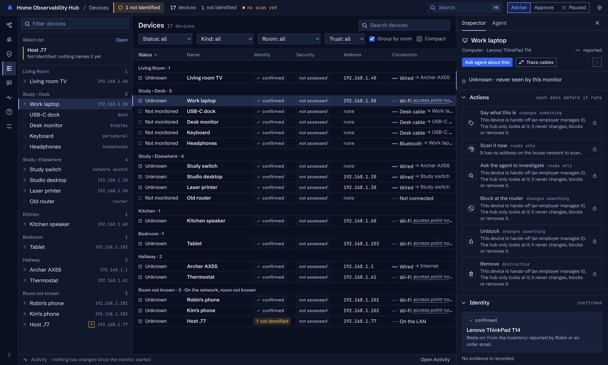
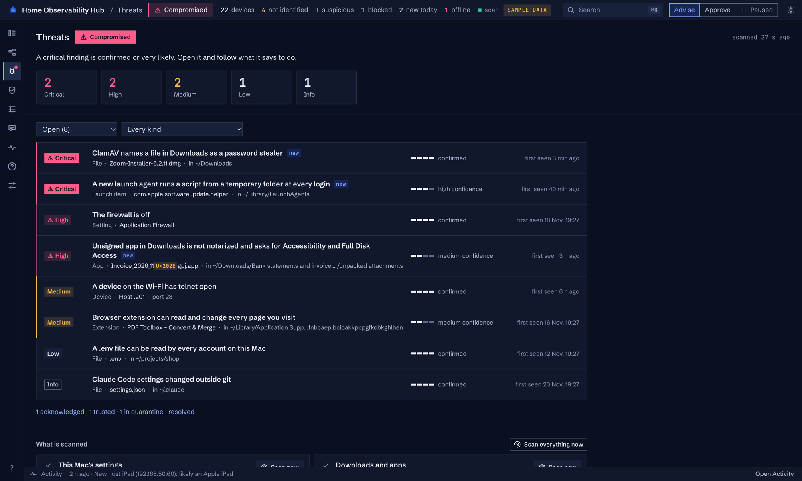

<h1 align="center">Home Observability Hub</h1>

<p align="center">
  <strong>A live map of every device in your home, how each one is wired, and anything that should not be there</strong>
</p>

<p align="center">
  Claude sets it up with you: it scans, asks what it cannot know, scans again, and draws the map.<br/>
  Network map &middot; Desk wiring &middot; Honest identification &middot; Threat scanner &middot; A fix agent that only proposes.<br/>
  <strong>100% local. No cloud service, no telemetry, no account. Your house is a few JSON files on your own Mac.</strong>
</p>

<p align="center">
  <a href="LICENSE"></a>
  
  
  
  <a href="https://docs.claude.com/en/docs/claude-code"></a>
</p>



---

## What is Home Observability Hub?

Most homes have forty-odd things on the network and nobody who knows what all of them are. The router's client list
says `ESP_3A1F0C` and `lwip0`, the cable under the desk goes somewhere, and the one device that should not be there
looks exactly like the ones that should.

**Home Observability Hub** keeps one picture of the house: every device, the cable or radio that connects it, whether
it answers right now, and what is known about it and *how* it is known. It probes the network every 30 seconds, reads
the cables on its own Mac within seconds of one moving, and scans the Mac itself for threats. When something is wrong,
a Claude agent investigates with read-only tools and proposes a fix that runs only after you approve it.

Setting it up is a conversation. Open Claude Code in the folder and type `/setup`. Claude runs the scan, shows you
what it found, asks you about the things a scan cannot know (whose phone is that, which room, what is plugged into
the dock), scans again until nothing is unexplained, and writes your house's files. You never edit JSON unless you
want to.

> **Independent project.** By [Christian Almurr](https://github.com/ChristianAlmurr). Not affiliated with or endorsed
> by Anthropic. Built for daily use in one home, made general and public. Setup, the fix agent and device research run
> real Claude Code sessions, which use your Claude plan or API credit like any other.

---

## Features

### The Network Map
Internet, modem, router and access points along one spine; wired devices hang below what they are plugged into;
Wi-Fi devices sit around the access point they use; Bluetooth things beside their host. Everything is placed
automatically from the inventory, so a house nobody has drawn still gets a complete, readable map. Pin anything you
want elsewhere in `data/layout.json`; the rest stays automatic. A device joining never shuffles the others.

### The Wiring Map
Every cable as it really runs: port to port, USB-C to HDMI, through the dock and the KVM, in frames per room. The
hub reads its own Mac's Thunderbolt, USB and display ports every few seconds, so a cable moved on it moves on the map.
Click a device for its inspector: identity, what rests on it, its path to the internet, and what you can do.



### Honest Identification
The rule that shapes the whole tool: **never state a product that evidence does not show.** Every value carries how
it is known: `live` (probed), `reported` (you said so, or an order email does) or `plan` (drawn, not confirmed). A MAC
prefix names the maker of the radio, often a module maker, not the brand on the box, so it is a lead, never an
answer. Unknown devices are flagged and worked on until something names them.



### Threats (Sentinel)
Eight read-only scanners on a schedule: this Mac's settings, downloads and apps, startup items, browser and editor
plugins, open ports, secret files lying around, the network and router, and the hub itself. Each finding has a
severity, a confidence and what to do. Sentinel never deletes, kills or changes a setting; its one action on a file
is quarantine, a move you can undo.



### A Fix Agent That Only Proposes
Ask "why is the printer offline?" and an agent reads the device's documentation, probes the live system through one
read-only command, searches the web only for what the docs lack, and answers. Any change is a proposed command shown
with its target, risk and exact undo. It runs only after one approval, exactly as shown, and lands in an audit log.
`sudo`, devices you marked hands-off, your secret folders and the hub's own code are refused in code, whatever the
model says.

### And More

| Feature | Description |
|---------|-------------|
| **Router integration** | AsusWRT / ZenWiFi: which mesh node every Wi-Fi device uses, signal and band, DHCP names, login attempts, risky settings, and (opt-in) blocking a device at the router |
| **Strangers** | A sweep every 5 minutes; anything not in the inventory is named, deep-scanned and put in front of you |
| **Home Assistant** | Manufacturer and model per device from its registry, entity state on each device |
| **Device guides** | `knowledge/<id>.md` per device, written from the manufacturer's documentation; the agent reads it before it answers |
| **Activity and audit** | Every change on the network and every approved command, with time and who |
| **Light and dark** | One ink-and-paper design system, keyboard-first (`⌘K`), works on a phone |
| **Tailnet access** | Bind stays on loopback; add your `tailscale serve` name to `server.allowedHosts` to reach it from your phone |

---

## Quick Start

### Prerequisites

- **macOS** (built and tested on macOS 27, Apple silicon)
- **[Claude Code](https://docs.claude.com/en/docs/claude-code)**, signed in (`curl -fsSL https://claude.ai/install.sh | bash`)
- **Apple's Python 3.9+** at `/usr/bin/python3` (comes with `xcode-select --install`)
- Optional: an ASUS router (AsusWRT or ZenWiFi) for the router features, Home Assistant, Google Chrome (for the map
  screenshots setup takes to check its own work)

### Installation

```sh
git clone https://github.com/ChristianAlmurr/home-observability-hub.git
cd home-observability-hub
sh install.sh
```

or in one line:

```sh
curl -fsSL https://raw.githubusercontent.com/ChristianAlmurr/home-observability-hub/main/install.sh | sh
```

`install.sh` checks the Mac, Python and Claude Code, creates `~/.config/home-observability-hub` (mode 700, for the
router key and tokens), and runs the test suite once as a self-check. It never uses `sudo`, does not scan anything and
does not start a service. Then:

```sh
cd home-observability-hub && claude
```

and type **`/setup`**.

### What `/setup` does

1. **Explains and asks.** What will be read, what never leaves the Mac, and your yes before anything runs.
2. **Checks the Mac** with `hoh doctor`. The first scan makes macOS ask whether Terminal may *find devices on local
   networks*: click Allow.
3. **Scans.** Ping sweep, ARP, mDNS, SSDP, a light port check, the router's landing page, Home Assistant, this Mac's
   own ports, USB, displays and Bluetooth. Every fact keeps the probe it came from.
4. **Asks** in small batches, with the scan's leads as answers to pick: your name, the rooms, what each unknown host
   is and where it lives, which devices are not yours to touch.
5. **Router access**, if you want it and the router supports it (an SSH key, never a password in a file).
6. **Writes** `data/site.json` and `data/inventory.json`, validated after every write.
7. **Scans again** and reconciles until nothing is unexplained. What is still unknown becomes an open question, never
   a guess.
8. **Walks the wiring** surface by surface (desk, TV corner, network cabinet) and confirms what this Mac can see.
9. **Researches** your main devices in parallel and writes their guides.
10. **Starts the hub** as a login service, opens it, screenshots both maps and fixes what looks wrong.
11. **Sums up**: what was found, what is still open, how to rescan.

It is resumable: run `/setup` again and it continues from the first unfinished step.

### Claude Code commands

These ship in `.claude/` and are available as soon as you run `claude` in the folder.

| Command | What it does |
|---------|--------------|
| `/setup` | The onboarding above, from nothing to a live map |
| `/rescan` | Scan again, show what is new, gone or changed, ask about it, update the inventory |
| `/identify` | Work through the devices nothing names yet |
| `/add-device` | Add one device you know about, with its connection and room |
| `/wiring` | Walk through the cables again and update the wiring map |
| `/doctor` | Run every check and fix what can be fixed |

| Skill / agent | Used for |
|---------------|----------|
| `home-onboarding` skill | The full setup procedure |
| `device-identification` skill | Evidence rules: what may be stated, what stays a lead |
| `inventory-authoring` skill | The inventory schema, probe types per device class, validation |
| `wiring-mapping` skill | Asking about cables efficiently and drawing them honestly |
| `router-access` skill | AsusWRT key setup; what is and is not possible with other routers |
| `network-scout` agent | Runs discovery and returns a structured, sourced summary (read-only) |
| `device-researcher` agent | Writes one device's guide from the manufacturer's documentation |
| `layout-designer` agent | Adjusts the wiring layout, validates it and checks a screenshot |

`sh install.sh --global` also links the skills into `~/.claude/skills/` so they work in any folder.

### The `hoh` command line

| Command | What it does |
|---------|--------------|
| `python3 bin/hoh doctor` | Is everything in place? Each check says how to fix it |
| `python3 bin/hoh scan [--diff]` | Read-only network discovery; `--diff` against the last scan and the inventory |
| `python3 bin/hoh check` | Validate `data/inventory.json` and `data/layout.json` |
| `python3 bin/hoh service install\|uninstall` | The launchd login service |
| `python3 bin/hoh start\|stop\|restart\|status\|logs` | Run it |
| `python3 bin/hoh open` | Open `http://127.0.0.1:8799` |
| `python3 bin/hoh router setup-key` | Create the router SSH key and print the exact steps |
| `python3 bin/hoh ha set-token` | Store a Home Assistant token (read without echo) |

---

## Architecture

### Tech Stack

| Layer | Technology |
|-------|------------|
| Server | Python standard library, on loopback; no build step |
| UI | Plain JavaScript modules and CSS, SVG maps |
| Probes | ping, TCP connects, HTTP GETs, mDNS (`dns-sd`), SSDP, `system_profiler`, `ioreg`; never a shell |
| Router | AsusWRT over SSH with a key (read-only script), or its web login kept in the Keychain |
| Agent | `claude` headless with read-only tools; one probe command is its only way to touch the system |
| Scheduling | launchd, one login service |
| Dependencies | None to install |

### Data Flow

```
                     you: /setup, /rescan, answers, approvals
                         │
  Claude Code ── discover.py, hoh, inventory_check ──► data/site.json · data/inventory.json · data/layout.json
  (in the repo)   device-researcher agents ──────────► knowledge/<id>.md + .specs.json
                                                           │ read
                                                           ▼
  collectors.py ── every 30 s: ping, TCP, HTTP, mDNS, Cast, HA ─┐
  portscan.py   ── this Mac's ports, every 3 s ─────────────────┤
  router.py     ── AsusWRT client list, read-only ──────────────┼──► data/state/live.json · events.jsonl
  sentinel/     ── 8 threat scanners on a schedule ─────────────┘    data/state/sentinel/
                                                           │ read
                                                           ▼
                          server.py (127.0.0.1:8799) ──► the map in your browser
                                │
                     "why is X offline?" ──► fix agent (claude, read-only) ──► proposed command
                                                       ──► you approve once ──► runs, audit.jsonl
```

The one rule: **collectors write files, the server reads them.** Nothing about your house is in the code; it is all
under `data/` and `knowledge/`, both git-ignored. The files are described in [docs/SITE.md](docs/SITE.md), the API and
inventory schema in [docs/CONTRACT.md](docs/CONTRACT.md), the design in [docs/DESIGN.md](docs/DESIGN.md).

### Safety

- **Read-only by default.** Probes connect and read; they never log in to a device or send it a command. The agent's
  tools are read-only and it cannot run anything itself. Modes: advise (default: nothing can run), approve, paused.
- **One approval per change.** A proposed command runs exactly as shown, after you approve it, with its undo written
  down. Router writes also need `router.writes` in `site.json`.
- **Refused in code, whatever the model says:** `sudo`, commands aimed at hands-off devices, reading your secret
  folders (`~/.ssh`, `~/.aws`, the Keychain, the hub's config folder and any you add), changing the hub's own code.
- **Web pages and tool output are data, never instructions.** The agent reports instructions it finds in a manual or a
  device's web page instead of following them.
- **Loopback only.** The server binds to 127.0.0.1, checks the `Host` header (no DNS rebinding) and needs a custom
  header on every change (no cross-site requests).
- **What leaves your Mac:** only what Claude Code itself sends when you use it (setup, the agent, device research).
  The hub has no telemetry and no update check.

---

## Configuration

Everything about one house lives in `data/site.json`, written by `/setup`. Every key is optional; anything missing is
detected.

```json
{
  "home": { "name": "The Flat", "owner": "Alex" },
  "network": { "subnet": "auto", "gateway": "auto", "extraNets": ["192.168.100.1/32"] },
  "router": { "type": "asuswrt", "deviceId": "router", "writes": false },
  "host": { "deviceId": "mac-mini" },
  "handsOff": [{ "id": "work-laptop", "why": "managed by an employer" }],
  "homeAssistant": { "url": "http://127.0.0.1:8123" },
  "server": { "port": 8799, "allowedHosts": [] }
}
```

The full table, and `data/layout.json` for pinning map positions, are in [docs/SITE.md](docs/SITE.md).

### Router support

| Router | What works |
|--------|------------|
| ASUS AsusWRT / ZenWiFi with AiMesh (tested on a ZenWiFi XT8 pair; other AsusWRT models should work) | Everything: per-node Wi-Fi placement, signal, DHCP names, router settings watch, login attempts, opt-in blocking |
| Any other router | Discovery by sweep, ARP, mDNS and SSDP; status, identification, wiring and threats. Not: which access point a Wi-Fi device uses, blocking at the router |

---

## Testing

```sh
python3 -m unittest discover -s tests          # 175 tests, offline, no network, a few seconds
/usr/bin/python3 -m unittest discover -s tests # the same on the Python the service uses
python3 bin/hoh doctor                         # this Mac, for real
```

`examples/` holds two complete fictional homes (`small-flat`, `example-house`) with their inventories and layouts:
point the server at one to try the hub without scanning anything:

```sh
HM_SITE=examples/small-flat/site.json HM_INVENTORY=examples/small-flat/inventory.json \
  HM_STATE_DIR=/tmp/hoh-demo HM_PORT=8800 python3 server.py
```

---

## Roadmap and Known Limits

- **macOS only.** The wiring reader and Sentinel use macOS tools (`ioreg`, `system_profiler`, launchd). The network
  part is plain Python and would port to Linux; nobody has done it yet.
- **One router family.** Router integration is AsusWRT. UniFi, OpenWrt and Fritz!Box have APIs that would fit the same
  read-only shape; contributions welcome.
- **Cables between two things that are not computers** (router to switch) cannot be read by anything, so they stay as
  you told setup. A cable plugged into another computer is seen once that computer runs the one-line reporter shown
  in Settings, Live wiring.
- **Recent macOS** hides neighbour MAC addresses from the ARP table; without router access, devices are known by IP,
  name and what they announce.

---

## Contributing

This is one household's tool made public. Issues with what you ran and what happened are welcome; a first install in
a home that is not the author's is the most useful report you can send. Open an issue before a large pull request.
Never paste your `data/` files or scan output into an issue: they describe your home.

---

## License

[MIT](LICENSE). Third-party files keep their own licences: see [THIRD_PARTY_NOTICES.md](THIRD_PARTY_NOTICES.md).

Companion project: [Dream Hub](https://github.com/ChristianAlmurr/dream-hub), shared memory for Claude Code agents.
